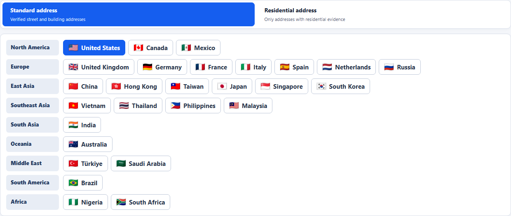
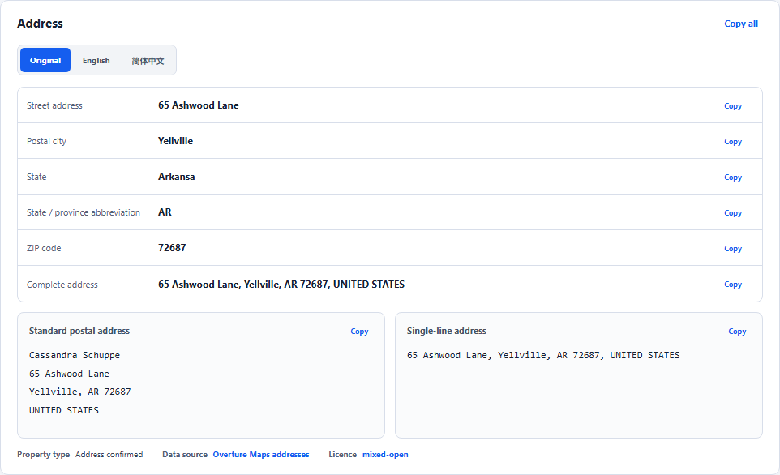

<div align="center">


# Address

**公的な登録データとオープンな地図データにもとづく、27 の国と地域に対応したセルフホスト型の実在住所ジェネレーター**

[English](README.md) · [简体中文](README.zh-CN.md) · [繁體中文](README.zh-TW.md) · 日本語

[](https://github.com/daimon3332/address/actions/workflows/ci.yml)
[](https://hub.docker.com/r/daimon23/address)
[](https://nodejs.org/)
[](https://www.postgresql.org/)
[](LICENSE)
[](https://address.333186.xyz)

</div>



## 概要

Address は、ランダムに組み立てた文字列ではなく、実際に存在する住所を返します。すべてのレコードは、公的な住所登録、オープンな地図データ、または検証済みのジオコーディングの結果から得たもので、その出典、精度、座標を持っています。欠けているフィールドは空のままにし、何もでっち上げません。

フォームや決済のテスト、住所形式の検証、物流のデモなど、住所が本物らしく見え、かつ本物である必要があるあらゆる場面で使えます。

## 機能

- **27 の国と地域** – 各国の実際の行政階層に沿った、地域、都市、地区、郵便番号のフィルター。データのないフィルターは、黙って別の地域に切り替えるのではなく、エラーを返します。
- **追跡できる出典** – 中国では住宅団地を、それ以外では建物レベルと通りレベルの住所を、精度と居住の根拠のラベル付きで提供します。
- **10 の表示言語** – 現地語、英語、簡体字と繁体字の中国語、日本語、韓国語、ドイツ語、フランス語、スペイン語、ポルトガル語。
- **手のかからない同期** – 回数に上限のあるリトライ、指数バックオフ、クォータの待機、ソースの枯渇の検出を備えた増分インポートで、失敗する処理が永遠に繰り返されることはありません。
- **管理コンソール** – ダッシュボード、国別のワークスペース、同期の履歴、クイックロケーション、プロバイダーの認証情報、翻訳のルーティング、アクセス制御、API トークン。
- **オープン API** – 単体とバッチでの生成、場所の検索、カバー範囲、住所の翻訳のための、Bearer 認証の JSON API と、OpenAPI 3.1 のドキュメント。
- **単一ファイルでのデプロイ** – 1 つの Docker Compose ファイルで、アプリ、PostgreSQL、マイグレーション、同期サービスを動かします。内部のシークレットは自動で生成され、保存されます。

## クイックスタート

### 要件

- Linux（AMD64 または ARM64）
- Docker Engine 24+ と Docker Compose v2
- 4 GB の RAM（大きな国の最初のインポートには 8 GB 以上を推奨）

### Docker Compose でのデプロイ

```bash
# 1. Create a deployment directory and download the Compose file
mkdir address && cd address
curl -fsSLo docker-compose.yml https://raw.githubusercontent.com/daimon3332/address/main/docker-compose.yml

# 2. Start all services
docker compose up -d

# 3. Check readiness
docker compose ps
curl -fsS http://127.0.0.1:8787/api/v1/ready
```

初回の起動時に、スタックは次のことを行います。

- Compose ファイルの隣に、永続化用の `data/` と `runtime/` ディレクトリを作成します。
- データベースのパスワード、設定の暗号化キー、サービスのトークンを `data/secrets/` に生成します。
- データベースのマイグレーションを実行してから、API と同期サービスを起動します。

### 初回のサインイン

1. `http://127.0.0.1:8787/admin/` を開き、初期パスワード `admin` でサインインします。
2. 求められたら、管理者のパスワードを変更します。
3. **アクセスとセキュリティ** で、公開ジェネレーターにパスワードを必要とするかどうかを決めます。
4. 外部のクライアント用に、**APIトークン** で API トークンを作成します。

> 最初から自分のパスワードを使うには、最初の `docker compose up -d` の前に `ADMIN_INITIAL_PASSWORD` を設定してください。

### 公開する

API は `127.0.0.1:8787` でのみ待ち受けます。HTTPS のリバースプロキシの後ろに置き、Compose ファイルの隣に `.env` を作成します。

```dotenv
ALLOWED_ORIGINS=https://address.example.com
TRUST_PROXY=true
COOKIE_SECURE=true
```

Nginx と Caddy の例、アップグレード、バックアップ、リストアについては、[デプロイガイド](docs/DEPLOYMENT.md)をご覧ください。

## 使い方

### Web

`http://127.0.0.1:8787/` を開き、国、地域、表示言語を選んで生成します。結果は、コピー、エクスポート、お気に入りへの保存ができ、Google Maps や AMap で開くこともできます。

### API

```bash
curl -fsS "http://127.0.0.1:8787/api/v1/generate?country=US&city=Seattle" \
  -H "Authorization: Bearer YOUR_API_TOKEN"
```

```json
{
  "data": {
    "country": "US",
    "filters": { "city": "Seattle" },
    "filterMatchLevel": "exact",
    "result": {
      "address": {
        "formattedAddress": "4019 Aikins Avenue Southwest, Seattle, WA, 98116",
        "matchLevel": "premise",
        "propertyType": "residential",
        "coordinates": { "latitude": 47.567944, "longitude": -122.40706 }
      }
    }
  }
}
```

レスポンスは省略しています。`matchLevel` は住所の精度（`street`、`premise`、`subpremise`）です。`propertyType` が `residential` になるのは、独立した居住の根拠がある場合だけです。すべてのエンドポイント、パラメーター、エラーコードについては、[API リファレンス](docs/API.md)をご覧ください。

### プロバイダーのキー（任意）

このサービスは、認可の不要なオープンなソースを使うので、サードパーティーのキーがなくても動作します。中国の地図プラットフォーム、Google Geocoding、翻訳サービスは、特定の国のデータを拡張したり、オンライン翻訳を有効にしたりするだけのものです。管理コンソールの **マップキー** で追加してください。それぞれの入手方法は、[API キー](docs/API_KEYS.md)をご覧ください。

## スクリーンショット

<table>
  <tr><th>管理 · ダッシュボード</th><th>管理 · 国別のワークスペース</th></tr>
  <tr>
    <td></td>
    <td></td>
  </tr>
  <tr><th>国の詳細</th><th>翻訳の認証情報のテスト</th></tr>
  <tr>
    <td></td>
    <td></td>
  </tr>
  <tr><th>公開のカバー範囲モニター</th><th>米国の住所</th></tr>
  <tr>
    <td></td>
    <td></td>
  </tr>
</table>

## 対応している国と地域

| 地域 | 国と地域 |
|---|---|
| 北米 | アメリカ合衆国 US、カナダ CA、メキシコ MX |
| ヨーロッパ | イギリス GB、ドイツ DE、フランス FR、イタリア IT、スペイン ES、オランダ NL、ロシア RU |
| 東アジア | 中国 CN、香港 HK、台湾 TW、日本 JP、韓国 KR |
| 東南アジア | シンガポール SG、マレーシア MY、タイ TH、フィリピン PH、ベトナム VN |
| 南アジア | インド IN |
| オセアニア | オーストラリア AU |
| 中東 | トルコ TR、サウジアラビア SA |
| 南米 | ブラジル BR |
| アフリカ | ナイジェリア NG、南アフリカ ZA |

国ごとの出典、フィールドの由来、居住の根拠は、[データソースのドキュメント](docs/data-sources.md)に記載しています。

## しくみ

```text
Browser ──► Astro + React pages
               │
               ▼
           Hono API ──► PostgreSQL (address pool, admin catalog, control data)
               │
               └─ prebuilt random/filter indexes, local formatting and translation

Sync service ──► official registers / OpenStreetMap / Overture / map platforms
               │  validates source, administrative area, language, coordinates
               ▼
           per-country transactional publish ──► PostgreSQL
```

国が完了とみなされるのは、有効な住所の総数、最下位の行政区のカバー率、階層ごとのノードの最低数という 3 つのルールを同時に満たしたときだけです。ソースに新しいものが何もないと確認されると、その国は **ソース上限** と表示され、ソースが変わるまでキューに戻らなくなります。

## ドキュメント

| ドキュメント | 内容 |
|---|---|
| [デプロイ](docs/DEPLOYMENT.md) | Docker Compose、リバースプロキシ、アップグレード、バックアップとリストア、トラブルシューティング |
| [API](docs/API.md) | 認証、エンドポイント、パラメーター、バッチ生成、エラー |
| [API キー](docs/API_KEYS.md) | 各プロバイダーの用途、キーの入手方法、管理画面での設定 |
| [開発](docs/DEVELOPMENT.md) | ローカルのセットアップ、プロジェクトの構成、テスト、リリース前のチェック |
| [データソース](docs/data-sources.md) | 出典、公開のルール、同期の流れ（中国語） |
| [国別の戦略](docs/strategies/) | 国ごとのフィールド、座標、重複の除去、検証（中国語） |

## ライセンス

ソースコードは [MIT License](LICENSE) のもとで公開されています。上流のデータセットには、それぞれ独自のライセンスと帰属表示の要件があります。[データソースのドキュメント](docs/data-sources.md)をご覧ください。

## コミュニティ

- [linux.do](https://linux.do)
