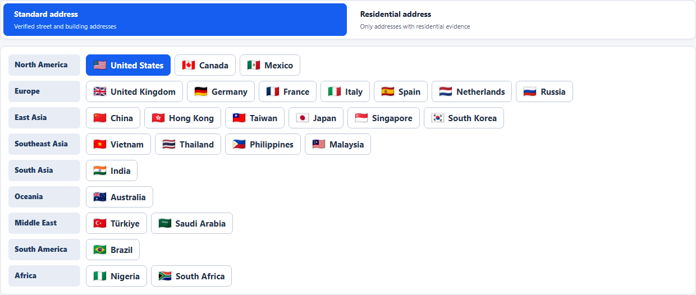
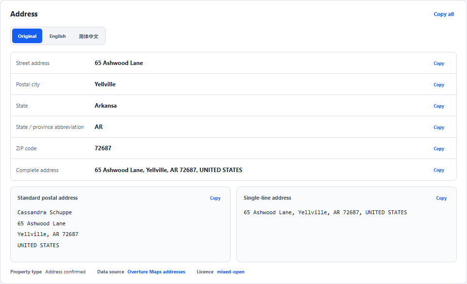

<div align="center">


# Address

**Self-hosted real-address generator backed by official registries and open map data for 27 countries and regions**

English · [简体中文](README.zh-CN.md) · [繁體中文](README.zh-TW.md) · [日本語](README.ja.md)

[](https://github.com/daimon3332/address/actions/workflows/ci.yml)
[](https://hub.docker.com/r/daimon23/address)
[](https://nodejs.org/)
[](https://www.postgresql.org/)
[](LICENSE)
[](https://address.333186.xyz)

</div>



## Overview

Address returns addresses that actually exist instead of randomly assembled strings. Every record comes from an official address register, open map data, or a validated geocoding result, and carries its source, precision, and coordinates. Missing fields stay empty; nothing is invented.

Use it for form and checkout testing, address-format validation, logistics demos, and anywhere an address must look real and be real.

## Features

- **27 countries and regions** – Region, city, district, and postcode filters that follow each country's real administrative hierarchy. A filter with no data returns an error instead of silently switching to another area.
- **Traceable sources** – Residential communities for China; premise- and street-level addresses elsewhere, labelled with precision and residential evidence.
- **Ten display languages** – Native, English, Simplified and Traditional Chinese, Japanese, Korean, German, French, Spanish, and Portuguese.
- **Hands-off synchronization** – Incremental imports with bounded retries, exponential backoff, quota waits, and source-exhaustion detection, so failing work is never repeated forever.
- **Admin console** – Dashboard, country workspace, sync history, quick locations, provider credentials, translation routing, access control, and API tokens.
- **Open API** – Bearer-authenticated JSON API for single and batch generation, location search, coverage, and address translation, with an OpenAPI 3.1 document.
- **Single-file deployment** – One Docker Compose file runs the app, PostgreSQL, migrations, and the sync service; internal secrets are generated and persisted automatically.

## Quick start

### Requirements

- Linux (AMD64 or ARM64)
- Docker Engine 24+ with Docker Compose v2
- 4 GB RAM (8 GB or more recommended for the first import of large countries)

### Deploy with Docker Compose

```bash
# 1. Create a deployment directory and download the Compose file
mkdir address && cd address
curl -fsSLo docker-compose.yml https://raw.githubusercontent.com/daimon3332/address/main/docker-compose.yml

# 2. Start all services
docker compose up -d

# 3. Check readiness
docker compose ps
curl -fsS http://127.0.0.1:8787/api/v1/ready
```

On first start the stack:

- creates persistent `data/` and `runtime/` directories next to the Compose file;
- generates the database password, configuration encryption key, and service tokens in `data/secrets/`;
- runs database migrations, then starts the API and the sync service.

### First sign-in

1. Open `http://127.0.0.1:8787/admin/` and sign in with the initial password `admin`.
2. Change the administrator password when prompted.
3. Decide under **Access & Security** whether the public generator needs a password.
4. Create an API token under **API Tokens** for external clients.

> To start with your own password, set `ADMIN_INITIAL_PASSWORD` before the first `docker compose up -d`.

### Go public

The API listens on `127.0.0.1:8787` only. Put it behind an HTTPS reverse proxy and create a `.env` next to the Compose file:

```dotenv
ALLOWED_ORIGINS=https://address.example.com
TRUST_PROXY=true
COOKIE_SECURE=true
```

See the [deployment guide](docs/DEPLOYMENT.md) for Nginx and Caddy examples, upgrades, backups, and restores.

## Usage

### Web

Open `http://127.0.0.1:8787/`, pick a country, area, and display language, and generate. Results can be copied, exported, saved to favorites, or opened in Google Maps or AMap.

### API

```bash
curl -fsS "http://127.0.0.1:8787/api/v1/generate?country=US&city=Seattle" \
  -H "Authorization: Bearer YOUR_API_TOKEN"
```

```json
{
  "data": {
    "country": "US",
    "filters": { "city": "Seattle" },
    "filterMatchLevel": "exact",
    "result": {
      "address": {
        "formattedAddress": "4019 Aikins Avenue Southwest, Seattle, WA, 98116",
        "matchLevel": "premise",
        "propertyType": "residential",
        "coordinates": { "latitude": 47.567944, "longitude": -122.40706 }
      }
    }
  }
}
```

The response is abridged. `matchLevel` is the address precision (`street`, `premise`, or `subpremise`); `propertyType` is `residential` only when independent residential evidence exists. See the [API reference](docs/API.md) for every endpoint, parameter, and error code.

### Provider keys (optional)

The service runs without any third-party key, using open sources that need no authorization. China map platforms, Google Geocoding, and translation services only extend data for specific countries or enable online translation; add them under **Map Keys** in the admin console. See [API keys](docs/API_KEYS.md) for how to obtain each one.

## Screenshots

<table>
  <tr><th>Admin · Dashboard</th><th>Admin · Country workspace</th></tr>
  <tr>
    <td></td>
    <td></td>
  </tr>
  <tr><th>Country detail</th><th>Translation credential test</th></tr>
  <tr>
    <td></td>
    <td></td>
  </tr>
  <tr><th>Public coverage monitor</th><th>US address</th></tr>
  <tr>
    <td></td>
    <td></td>
  </tr>
</table>

## Supported countries and regions

| Region | Countries and regions |
|---|---|
| North America | United States US, Canada CA, Mexico MX |
| Europe | United Kingdom GB, Germany DE, France FR, Italy IT, Spain ES, Netherlands NL, Russia RU |
| East Asia | China CN, Hong Kong HK, Taiwan TW, Japan JP, South Korea KR |
| Southeast Asia | Singapore SG, Malaysia MY, Thailand TH, Philippines PH, Vietnam VN |
| South Asia | India IN |
| Oceania | Australia AU |
| Middle East | Türkiye TR, Saudi Arabia SA |
| South America | Brazil BR |
| Africa | Nigeria NG, South Africa ZA |

Sources, field provenance, and residential evidence per country are listed in the [data sources document](docs/data-sources.md).

## How it works

```text
Browser ──► Astro + React pages
               │
               ▼
           Hono API ──► PostgreSQL (address pool, admin catalog, control data)
               │
               └─ prebuilt random/filter indexes, local formatting and translation

Sync service ──► official registers / OpenStreetMap / Overture / map platforms
               │  validates source, administrative area, language, coordinates
               ▼
           per-country transactional publish ──► PostgreSQL
```

A country is complete only when three rules hold at once: the valid-address total, the lowest-level administrative coverage, and the per-level node minimums. When a source is proven to have nothing new, the country shows **Source limit reached** and stops re-entering the queue until the source changes.

## Documentation

| Document | Contents |
|---|---|
| [Deployment](docs/DEPLOYMENT.md) | Docker Compose, reverse proxy, upgrades, backup and restore, troubleshooting |
| [API](docs/API.md) | Authentication, endpoints, parameters, batch generation, errors |
| [API keys](docs/API_KEYS.md) | What each provider is for, how to obtain keys, admin setup |
| [Development](docs/DEVELOPMENT.md) | Local setup, project layout, tests, release checks |
| [Data sources](docs/data-sources.md) | Sources, publication rules, synchronization flow (Chinese) |
| [Country strategies](docs/strategies/) | Per-country fields, coordinates, deduplication, validation (Chinese) |

## License

Source code is released under the [MIT License](LICENSE). Upstream datasets keep their own licenses and attribution requirements; see the [data sources document](docs/data-sources.md).

## Community

- [linux.do](https://linux.do)
