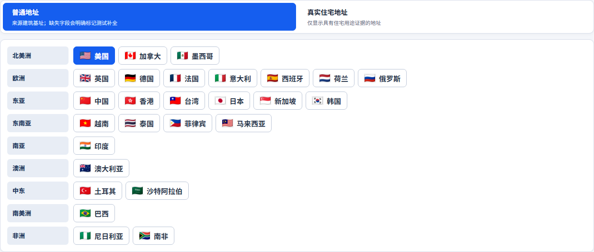
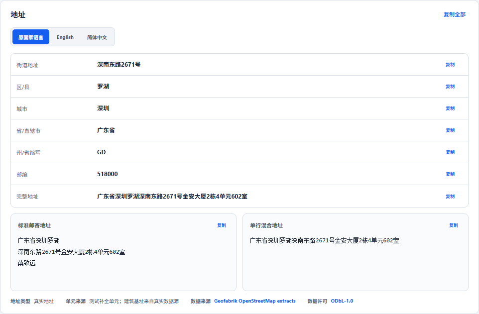

<div align="center">


# Address

**自托管的真实地址生成服务：数据来自官方登记与开放地图，覆盖 27 个国家和地区**

[English](README.md) · 简体中文 · [繁體中文](README.zh-TW.md) · [日本語](README.ja.md)

[](https://github.com/daimon3332/address/actions/workflows/ci.yml)
[](https://hub.docker.com/r/daimon23/address)
[](https://nodejs.org/)
[](https://www.postgresql.org/)
[](LICENSE)
[](https://address.333186.xyz)

</div>



## 简介

Address 返回的是真实存在的地址，而不是随机拼接的字符串。每一条地址都来自官方地址登记、开放地图数据或经过校验的地理编码结果，并带有来源、精度和坐标。缺失的字段保持为空，不会被编造。

适合用于表单与物流流程测试、地址格式校验、地理数据演示等需要“看起来真实、也确实真实”的地址场景。

## 特性

- **27 个国家和地区**：按各国真实的行政层级提供州省、城市、区县和邮编筛选；所选范围没有数据时直接报错，不会悄悄换成别的地区。
- **来源可追溯**：中国使用住宅小区地址；其他国家同时提供门牌级和街道级地址，并明确标注精度与住宅证据。
- **十种显示语言**：原文、英文、简体中文、繁体中文、日语、韩语、德语、法语、西班牙语、葡萄牙语。
- **全自动同步**：后台持续从各数据源增量同步，自带有限重试、指数退避、额度等待和来源耗尽判定，不会无休止地重复失败任务。
- **管理后台**：仪表盘、国家工作台、同步历史、快捷区域、平台凭据、翻译路由、访问控制和 API 令牌。
- **开放 API**：Bearer 鉴权的 JSON API，支持单条与批量生成、地区搜索、覆盖查询和地址翻译，并提供 OpenAPI 3.1 描述。
- **一个文件部署**：Docker Compose 一次拉起应用、PostgreSQL、迁移与同步服务，内部密钥自动生成并持久化。

## 快速开始

### 前置条件

- Linux（AMD64 或 ARM64）
- Docker Engine 24+ 与 Docker Compose v2
- 4 GB 内存（首次同步大型国家建议 8 GB 以上）

### 使用 Docker Compose 部署

```bash
# 1. 创建部署目录并下载 Compose 文件
mkdir address && cd address
curl -fsSLo docker-compose.yml https://raw.githubusercontent.com/daimon3332/address/main/docker-compose.yml

# 2. 启动全部服务
docker compose up -d

# 3. 确认服务就绪
docker compose ps
curl -fsS http://127.0.0.1:8787/api/v1/ready
```

启动时会自动完成：

- 在当前目录下创建 `data/`、`runtime/` 等持久化目录；
- 生成数据库密码、配置加密密钥和服务间令牌，保存在 `data/secrets/`；
- 执行数据库迁移，然后启动 API 与自动同步服务。

### 首次登录

1. 浏览器打开 `http://127.0.0.1:8787/admin/`，使用初始密码 `admin` 登录；
2. 按提示立即修改管理员密码；
3. 在“访问与安全”中决定是否开启前端访问密码；
4. 在“接口令牌”中创建 API 令牌，供外部程序调用。

> 想在首次启动前就使用自定义密码，可以在 `docker compose up -d` 之前设置 `ADMIN_INITIAL_PASSWORD`。

### 对外提供服务

API 默认只监听本机 `127.0.0.1:8787`。正式环境请放在 HTTPS 反向代理之后，并在 Compose 目录创建 `.env`：

```dotenv
ALLOWED_ORIGINS=https://address.example.com
TRUST_PROXY=true
COOKIE_SECURE=true
```

Nginx / Caddy 配置示例、升级、备份与恢复见[部署文档](docs/DEPLOYMENT.zh-CN.md)。

## 使用

### 网页

打开 `http://127.0.0.1:8787/`，选择国家、地区和显示语言即可生成地址。结果可复制、导出、收藏，或直接在 Google 地图 / 高德地图中定位。

### API

```bash
curl -fsS "http://127.0.0.1:8787/api/v1/generate?country=US&city=Seattle" \
  -H "Authorization: Bearer YOUR_API_TOKEN"
```

```json
{
  "data": {
    "country": "US",
    "filters": { "city": "Seattle" },
    "filterMatchLevel": "exact",
    "result": {
      "address": {
        "formattedAddress": "4019 Aikins Avenue Southwest, Seattle, WA, 98116",
        "matchLevel": "premise",
        "propertyType": "residential",
        "coordinates": { "latitude": 47.567944, "longitude": -122.40706 }
      }
    }
  }
}
```

响应已省略部分字段。`matchLevel` 表示地址精度（`street` / `premise` / `subpremise`），`propertyType` 只有在存在独立住宅证据时才为 `residential`。

全部端点、参数和错误码见 [API 文档](docs/API.zh-CN.md)。

### 平台密钥（可选）

没有任何第三方密钥也能运行，项目会使用无需授权的开放数据源。中国地图平台、Google Geocoding、翻译服务等密钥只用于扩充特定国家的数据或启用在线翻译，在后台“地图密钥”中添加即可。申请方式见 [API Key 配置](docs/API_KEYS.zh-CN.md)。

## 截图

<table>
  <tr><th>管理后台 · 仪表盘</th><th>管理后台 · 国家工作台</th></tr>
  <tr>
    <td></td>
    <td></td>
  </tr>
  <tr><th>国家详情</th><th>翻译凭据测试</th></tr>
  <tr>
    <td></td>
    <td></td>
  </tr>
  <tr><th>公开数据监控</th><th>中国地址生成</th></tr>
  <tr>
    <td></td>
    <td></td>
  </tr>
</table>

## 支持的国家和地区

| 区域 | 国家和地区 |
|---|---|
| 北美 | 美国 US、加拿大 CA、墨西哥 MX |
| 欧洲 | 英国 GB、德国 DE、法国 FR、意大利 IT、西班牙 ES、荷兰 NL、俄罗斯 RU |
| 东亚 | 中国 CN、中国香港 HK、中国台湾 TW、日本 JP、韩国 KR |
| 东南亚 | 新加坡 SG、马来西亚 MY、泰国 TH、菲律宾 PH、越南 VN |
| 南亚 | 印度 IN |
| 大洋洲 | 澳大利亚 AU |
| 中东 | 土耳其 TR、沙特阿拉伯 SA |
| 南美 | 巴西 BR |
| 非洲 | 尼日利亚 NG、南非 ZA |

各国使用的数据源、字段来源与住宅证据见[数据源说明](docs/data-sources.md)。

## 工作原理

```text
浏览器 ──► Astro + React 页面
              │
              ▼
          Hono API ──► PostgreSQL（地址池、行政目录、控制数据）
              │
              └─ 预构建的随机/筛选索引、本地格式化与翻译

同步服务 ──► 官方登记 / OpenStreetMap / Overture / 地图平台
              │  校验来源、行政归属、语言与坐标
              ▼
          以国家为单位的事务发布 ──► PostgreSQL
```

一个国家要同时满足三条规则才算同步完成：有效地址总量达标、最低一级行政区覆盖率达标、各级行政区的最低数量达标。来源已被证明没有新数据时，该国家会显示“来源已达上限”，不再反复进入执行队列。

## 文档

| 文档 | 内容 |
|---|---|
| [部署](docs/DEPLOYMENT.zh-CN.md) | Docker Compose、反向代理、升级、备份恢复、常见问题 |
| [API](docs/API.zh-CN.md) | 鉴权、端点、参数、批量生成、错误码 |
| [API Key](docs/API_KEYS.zh-CN.md) | 各平台用途、申请步骤与后台配置 |
| [开发](docs/DEVELOPMENT.zh-CN.md) | 本地开发、项目结构、测试与发布检查 |
| [数据源](docs/data-sources.md) | 各国数据来源、发布规则与同步流程 |
| [国家策略](docs/strategies/) | 每个国家的字段、坐标系、去重与验证细节 |

## 许可证

源码以 [MIT](LICENSE) 许可发布。各上游数据集保留其原有许可与署名要求，详见[数据源说明](docs/data-sources.md)。

## 社区

- [linux.do](https://linux.do)
